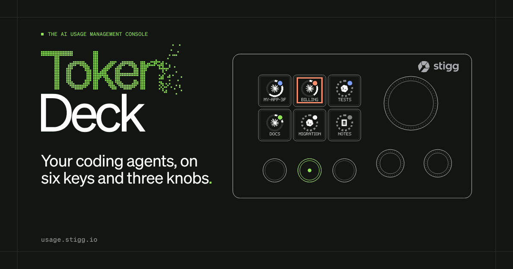

<p align="center">
  <a href="https://usage.stigg.io"></a>
</p>

# Token Deck

Token Deck is the free desktop app for the deck in the After Tokens box: a Stream Dock N3 with six screen keys, three metal buttons and three knobs. It puts your Claude Code, Codex and OpenCode sessions on the keys and takes you to the one that needs you. It also sets the model, effort and permission your next session starts with, and shows how much of your 5-hour and weekly limits you've used.

It runs on macOS and Windows, lives in the menu bar (the system tray on Windows) and talks to the deck over USB. There's no account and no telemetry.

**Download:** [usage.stigg.io](https://usage.stigg.io) (`io.stigg.io/usage`, the address printed on the box and the deck, leads there) · [All releases](https://github.com/stiggio/token-deck/releases)

- [Install](#install)
- [Using the deck](#using-the-deck)
- [Your own modes](#your-own-modes)
- [What Token Deck changes on your computer](#what-token-deck-changes-on-your-computer)
- [Troubleshooting](#troubleshooting)
- [Known issues](#known-issues)
- [The welcome screen](#the-welcome-screen)
- [Development](#development)
- [License](#license)

## Install

### macOS

macOS 12 or later, on Apple silicon or Intel. Paste this into Terminal:

```bash
/bin/bash -c "$(curl -fsSL https://usage.stigg.io/install.sh)"
```

The [script](site/install.sh) downloads the build for your Mac from the latest release, checks its SHA-256, quits Token Deck if it's running, installs it in `/Applications` (or `~/Applications` when `/Applications` isn't writable) and opens it. It doesn't use `sudo`.

Token Deck isn't notarized by Apple yet. The install command works anyway, because `curl` doesn't mark the download as quarantined. The disk images ([Apple silicon](https://github.com/stiggio/token-deck/releases/latest/download/TokenDeck-mac-arm64.dmg), [Intel](https://github.com/stiggio/token-deck/releases/latest/download/TokenDeck-mac-x64.dmg)) are quarantined, so macOS refuses to open the app or says it's damaged. After you drag it to Applications, run this and open it again:

```bash
xattr -d com.apple.quarantine "/Applications/Token Deck.app"
```

### Windows

Windows 10 or 11, 64-bit. Download and run [TokenDeck-win-x64.exe](https://github.com/stiggio/token-deck/releases/latest/download/TokenDeck-win-x64.exe). The installer isn't code-signed yet, so SmartScreen says "Windows protected your PC": choose **More info**, then **Run anyway**.

### First run

If the deck maker's StreamDock or VSD Craft app is running, quit it before you plug in the deck. Only one program can use the deck at a time.

The first time Token Deck starts, it offers three steps. You can skip any of them and do it later in the app's window, which opens from the menu bar or tray icon: Claude Code and the macOS permissions are on its This Mac page, and starting at login is on its About page.

1. Connect Claude Code. Token Deck adds its hooks and status line to `~/.claude/settings.json`, next to anything you already have, and keeps a backup ([details](#claude-code)).
2. On macOS, grant Accessibility and Automation, so the deck can bring windows to the front.
3. Start Token Deck at login.

## Using the deck

The three metal buttons under the keys pick the mode, and the deck remembers the last one.

| Button | Mode | What the keys show |
|---|---|---|
| Left | [Agents](#agents) | Claude Code, Cursor, Codex, OpenCode, Amp and Devin |
| Middle | [Sessions](#sessions) | Your live Claude Code, Codex and OpenCode sessions, newest first |
| Right | [Models & Usage](#models--usage) | Your 5-hour and weekly usage, then up to five models |

Hold the middle button to open [your own modes](#your-own-modes).

Turning a knob shows a short message across the top row of keys for 5 seconds, like `SONNET` `NEXT` `SESSION`. Key presses are ignored while a message is showing. `NOT AVAILABLE` means the agent can't do what you asked; `NONE INSTALLED` means none of Claude Code, Codex or OpenCode is installed.

### Agents

Press a key to go to that agent's latest session or window, or to open it if it isn't running. A dim key means the app isn't installed. Claude Code opens in the Claude desktop app when you have it, and in Terminal otherwise. Amp's key opens VS Code, and Devin's opens [app.devin.ai](https://app.devin.ai).

The left and right knobs act on the last of Claude Code, Codex or OpenCode whose key or session you pressed, or the first one installed.

| Control | Turn | Press |
|---|---|---|
| Big knob | Hop between the open agent windows | Back to the previous window |
| Left knob | The model your next session starts with | Back to the agent's default model |
| Right knob | The effort your next session starts with | Back to the agent's default effort |

### Sessions

Each key is one recent session, newest first. The dot shows what it's doing, and the ring shows how full its context window is. Only Claude Code reports context, so Codex and OpenCode sessions get a dashed ring.

| Dot | Status |
|---|---|
| Blue | Working |
| Coral, with a frame around the key | Needs your approval |
| White | Waiting for your reply |
| Gray | Idle |
| Lime | Done |

Press a key to jump to that session's window, and Models & Usage then shows that session's agent. Token Deck finds the exact tab in Terminal, iTerm2 and Ghostty, the right window in VS Code and Cursor, or the session in the Claude desktop app; for other terminals it brings the app forward. For Codex and OpenCode it looks for the terminal running the agent in that session's folder, and a Codex session without one opens in the Codex app. A finished Claude Code session that isn't running anymore reopens with `claude --resume`. On Windows, Token Deck brings Windows Terminal forward, without picking the tab.

| Control | Turn | Press |
|---|---|---|
| Big knob | The next or previous six sessions | The next page with a session that needs you |
| Left knob | Filter by agent | All agents |
| Right knob | Filter by status: all, working, needs you, idle, done | All statuses |

OpenCode sessions show up while `opencode serve` is running (Token Deck looks at `http://127.0.0.1:4096` and uses `OPENCODE_SERVER_PASSWORD` if you set one). OpenCode 2.x is found through its own service file.

The deck never approves a tool call. Pressing a session that needs approval takes you to its window, and you decide there.

### Models & Usage

Models & Usage shows one agent at a time; the left knob switches between Claude Code, Codex and OpenCode. The first key shows how much of that agent's 5-hour (`5H`) and weekly (`7D`) limits you've used. Press it to see the exact numbers and reset times in the app's window. The other keys are up to five of its models, with the current one in lime. Press a model and your next session starts on it.

| Control | Turn | Press |
|---|---|---|
| Big knob | Effort | Ultracode on or off (Claude Code) |
| Left knob | Agent | Back to the agent of the last session you opened |
| Right knob | Permission: `READ`, `ASK`, `AUTO`, `FULL` | Apply it |

Turning the right knob only previews a permission level; nothing changes until you press it (a press before any turn just shows `TURN` `FIRST`), and `FULL` waits until you confirm it in a dialog on the computer. Model, effort and permission changes go into the agent's own settings file and apply from your next session, and the deck confirms each one, like `SONNET` `NEXT` `SESSION` or `HIGH` `EFFORT`. Sessions that are already running keep what they started with.

Where the usage numbers come from:

- **Claude Code** reports them in its status line on Pro and Max plans, after a session's first reply.
- **Codex** reports them through `codex app-server` when you're signed in with ChatGPT. Token Deck asks once a minute.
- **OpenCode** doesn't report limits, so the key shows `--`.

The deck shows the last reading it got for up to 24 hours, then `--`, and drops a window as soon as its reset time passes. On Windows, Claude Code's status line isn't installed yet, so its usage and context don't show there.

The models come from each agent: Claude Code's model list (Opus, Sonnet, Haiku and Fable until it has one), the models Codex offers you, and OpenCode's configured model followed by its providers' models. Reorder them on the app's Models page.

What each permission level writes:

| Deck | Claude Code `permissions.defaultMode` | Codex `sandbox_mode`, `approval_policy` | OpenCode 1.x `permission` |
|---|---|---|---|
| `READ` | `plan` | `read-only`, `on-request` | edit `ask`, bash `ask` |
| `ASK` | `default` | `workspace-write`, `on-request` | edit `allow`, bash `ask` |
| `AUTO` | `auto` | `workspace-write`, `never` | edit `allow`, bash `allow` |
| `FULL` | `bypassPermissions` | `danger-full-access`, `never` | edit `allow`, bash `allow` |

Claude Code's effort levels are `low`, `medium`, `high` and `xhigh`. Codex offers whichever levels the selected model supports. Token Deck writes Claude Code's as `modelSettings.<model>.effortLevel`, or as `effortLevel` before Claude Code 2.1.251.

### Without a deck

The app's window has a simulator: the deck drawn at the bottom shows the same key images and behaves like the real one. Click a key, or use the keyboard:

| Key | Does |
|---|---|
| `1` to `6` | Press a screen key |
| `Q` `W` `E` | Press the left, middle or right metal button (hold Shift to hold it, which opens your own modes from the middle button) |
| `←` `→` | Turn the big knob |
| `↑` `↓` | Turn the left knob |
| `,` `.` | Turn the right knob |
| `Enter` | Press the big knob (Shift: the left knob, Option: the right knob) |

## Your own modes

A mode is a JSON file in `~/.tokendeck/modes/`. Hold the middle button and the keys list your modes, up to six; press one to open it. Any metal button takes you back. With no mode files, holding the middle button just opens Sessions. Token Deck reloads a file when you save it, even while that mode is open, and the app's Deck page lists any problems in your files.

```json
{
  "name": "Deploy",
  "tiles": [
    { "label": "BUILD", "icon": "~/icons/hammer.svg",
      "action": { "type": "shell", "command": "npm run build", "cwd": "~/dev/app" } },
    { "label": "LOGS", "action": { "type": "url", "url": "https://grafana.example.com/d/abc" } },
    { "label": "EDITOR", "action": { "type": "open", "app": "Cursor" } },
    { "label": "PALETTE", "action": { "type": "keys", "keys": "cmd+shift+p" } },
    { "label": "AGENTS", "action": { "type": "mode", "mode": "agents" } },
    null
  ],
  "knobs": {
    "main": {
      "cw": { "type": "keys", "keys": "cmd+=" },
      "ccw": { "type": "keys", "keys": "cmd+-" },
      "click": { "type": "shell", "command": "say done" }
    },
    "left": null,
    "right": null
  }
}
```

`tiles` holds up to six keys, left to right and top to bottom; `null` leaves a key empty, and pressing an empty key or turning a knob with no action shows `FAILED`. A label is shown in capitals, one word per line, two lines at most. `icon` is an optional PNG or SVG, drawn at 28 pixels. `knobs` maps `main` (the big knob), `left` and `right` to an action for `cw` (clockwise), `ccw` (counter-clockwise) and `click`.

| Action | Fields | Does |
|---|---|---|
| `shell` | `command`, optional `cwd` | Runs the command in your login shell (`zsh -lic` on macOS, `cmd /c` on Windows), for up to 10 seconds. The deck shows `OK` or `FAILED`. |
| `open` | `app` | Opens an app by name. |
| `url` | `url` | Opens a link in your browser. |
| `keys` | `keys` | Sends a shortcut to the app in front. On macOS write it like `cmd+shift+p` (`cmd`, `ctrl`, `opt`, `shift`). On Windows the string goes to `SendKeys` as is, so use its syntax: `^+p`. |
| `mode` | `mode` | Switches to `agents`, `sessions` or `models`. |

## What Token Deck changes on your computer

### Claude Code

From launch, Token Deck reads `claude agents --json --all` every two seconds, plus the session files under `~/.claude/sessions` and `~/.claude/projects`, to list your sessions, and the list of running processes to see which model each session runs. It never reads Claude Code's credentials; `claude auth status --json` tells it whether you're signed in.

When you connect Claude Code (in the first-run setup, or on the app's This Mac page), Token Deck:

1. Copies `~/.claude/settings.json` to `~/.claude/settings.json.tokendeck-backup`. This happens once; reconnecting keeps the first backup.
2. Writes two small scripts, `~/.tokendeck/bin/hook` and `~/.tokendeck/bin/statusline` (`hook.ps1` on Windows).
3. Sets its hook on seven events in `settings.json`: `UserPromptSubmit`, `Stop`, `Notification`, `PermissionRequest` and `PostModelSwitch` run in the background, and `SessionStart` and `SessionEnd` run with a two-second limit. Token Deck adds its hook next to any hooks you already have on those events. The hook is a `command` hook that exits at once when Token Deck isn't running, so a quit or crashed app never shows hook errors in your sessions.
4. Points the status line at `~/.tokendeck/bin/statusline` (macOS only). Your previous status line command is saved in `~/.tokendeck/statusline-original.json`, and the script runs it with the same input, so your status line looks the same. The script also keeps the latest status line data in `~/.tokendeck/last-statusline.json`, which is where the context ring and usage numbers come from.

**Stop watching** on the This Mac page takes Token Deck's hooks out and puts your previous status line back, and leaves everything else in `settings.json` as it is now. The backup from your first connect stays next to it if you ever want to go further back.

Token Deck never writes a `settings.json` it can't parse: if the file isn't valid JSON, it leaves it alone and tells you.

When you turn a knob, Token Deck writes `model`, the effort setting, `permissions.defaultMode` or `ultracode` in `settings.json`, keeping everything else in the file.

### Codex

Token Deck runs `codex app-server` in the background to read your sessions, models and usage limits. It never answers an approval request; you approve in Codex.

A knob writes the top-level `model`, `model_reasoning_effort`, `sandbox_mode` and `approval_policy` lines in `~/.codex/config.toml`. It edits those lines in place and adds missing ones at the top, so other comments and settings stay as they are, and it never touches `notify`. Before the first edit it copies the file to `~/.codex/config.toml.tokendeck-backup`; to undo, copy that file back.

### OpenCode

Token Deck reads sessions and the available models from the OpenCode server. A knob writes `model` in `~/.config/opencode/opencode.json`, and on 1.x sets `edit` and the default `bash` rule in its `permission` map, keeping your per-command rules. Before the first change it copies the file to `opencode.json.tokendeck-backup`. If you set `OPENCODE_SERVER_PASSWORD` in your shell profile, Token Deck reads it from your login shell.

### Cursor, Amp and Devin

Their keys only open or focus the app. Token Deck doesn't read or change anything of theirs.

### macOS permissions

To bring a window to the front, macOS asks once for Automation for each app Token Deck controls (Terminal, iTerm2, System Events and so on), and once for Accessibility under System Settings → Privacy & Security. Custom-mode keystrokes use the same permissions. Updates on macOS may ask again, because Token Deck isn't signed.

### Network and data

- Hooks reach the app through a server on `127.0.0.1` only, on a random port, behind a random per-install token in the path. Its address is in `~/.tokendeck/url` while the app runs.
- Token Deck only goes online for updates: it checks this repository's GitHub releases when it starts, Windows downloads a new version in the background, and Update now on a Mac runs the install script from `usage.stigg.io`.
- There's no telemetry. The log stays on your computer, in `~/.tokendeck/log/tokendeck.log`, rotated at 5 MB.

Token Deck's own files are in `~/.tokendeck`: `settings.json` (the app's own settings), `log/`, `bin/`, `modes/`, `url` and the status line files above. The backups sit next to the files they back up, and Electron keeps a cache in `~/Library/Application Support/Token Deck` (`%APPDATA%\Token Deck` on Windows).

## Troubleshooting

**The deck only shows the welcome screen.** Check that Token Deck is running: look for its icon in the menu bar or the system tray. Then unplug the deck and plug it back in. The app's Deck page shows the connection state.

**"Quit the StreamDock or VSD Craft app to use Token Deck."** Another program has the deck. Quit it and replug the deck.

**"Deck not responding. Unplug it and plug it back in."** The deck stopped answering. Replugging resets it.

**A key doesn't bring the window forward.** Give Token Deck Accessibility in System Settings → Privacy & Security, and allow the Automation prompts. The app's This Mac page says when Accessibility is missing.

**The usage key shows `--`.** Claude Code only reports limits on Pro and Max plans, after a session's first reply, and only through the status line, so connect Claude Code first. Codex needs a ChatGPT sign-in. OpenCode has no limits to show.

**Codex keys say `NOT AVAILABLE`.** Token Deck couldn't reach `codex app-server`. Check that `codex` runs in your terminal and that you're signed in.

**macOS says the app is damaged.** See the disk image note under [Install](#macos).

**Logs.** About → Show log opens `~/.tokendeck/log/tokendeck.log`.

**Uninstall.** Click Stop watching on the This Mac page to take Token Deck out of your Claude Code settings. Quit Token Deck from its menu and delete the app (on Windows, from Settings → Apps). Delete `~/.tokendeck` and the Electron cache folder above to remove the rest. If you changed Codex or OpenCode defaults from the deck, the originals are in `~/.codex/config.toml.tokendeck-backup` and `~/.config/opencode/opencode.json.tokendeck-backup`.

## Known issues

- On Windows, Token Deck doesn't chain Claude Code's status line, so Claude Code's context ring and usage don't show there. Claude Code's own status line support on Windows is still unreliable, and a broken chain would blank yours.
- On OpenCode 2.x, the deck can't change the permission setting yet; it says `NOT AVAILABLE`.

## The welcome screen

The deck keeps one picture in its own memory: the welcome screen with the Stigg logo, `io.stigg.io/usage` and the After Tokens token explosion. It shows whenever the deck has power and no app is driving it, on any computer. The decks in the After Tokens boxes came with it, and Token Deck writes it once to any deck it hasn't seen before. The About page can write it again, or turn the automatic write off.

How the write works, the batch tool the Stigg team used to prepare the giveaway decks, and how to recover a deck that starts up black are in [docs/welcome-screen.md](docs/welcome-screen.md).

## Development

You need Node 22 and npm. The app runs on macOS and Windows; the tests and the site build also run on Linux.

```bash
npm install
```

```bash
npm run dev
```

```bash
npm test
```

`npm run dev` starts the app with the settings window and the simulator. `npm test` runs the unit tests: the protocol (including that no frame Token Deck can send clears the deck or puts it to sleep), the input decoder against a real capture, the write queue, the welcome-screen write sequence, JPEG encoding and the tile renderer. With a deck plugged in and the app quit, `TOKENDECK_DEVICE=1 npm test` also runs the hardware test.

| Command | Does |
|---|---|
| `npm run build` | Compiles the app into `out/` and runs the font check |
| `npm run dist:mac` | Builds the macOS disk images and zips (Apple silicon and Intel) |
| `npm run dist:win` | Builds the Windows installer |
| `npm run site` | Renders the site's tiles and writes `site/index.html` |
| `npm run icons` | Rebuilds the tray icons |

**Releases.** Pushing a `v*` tag runs `.github/workflows/release.yml`: it builds both platforms, starts each build once with `--smoke` to check the native modules and resources, and publishes the release. The file names never change (`TokenDeck-mac-arm64.zip`, `TokenDeck-win-x64.exe` and so on), so the download links always point at the latest release. The macOS builds are unsigned; adding the `CSC_LINK`, `CSC_KEY_PASSWORD`, `APPLE_ID`, `APPLE_APP_SPECIFIC_PASSWORD` and `APPLE_TEAM_ID` secrets turns on signing, notarization and the built-in updater.

**The site.** `site/` is the page at [usage.stigg.io](https://usage.stigg.io), published by GitHub Pages (`.github/workflows/pages.yml`) when `main` changes. `scripts/export-site-tiles.ts` renders the device tiles with the app's own renderer, and `scripts/build-site.mjs` writes `index.html` around `site/style.css` and `site/main.js`. The page uses only Stigg's Söhne, loaded from the same CDN files stigg.io uses; if marketing re-uploads those fonts in Webflow, update the four URLs at the top of `build-site.mjs`.

**Fonts.** Söhne's license doesn't allow it in the app or in this repository, so the app uses Geist and the tiles use a bitmap font drawn in code. `node scripts/lint-fonts` fails if a Söhne file, or any font other than Geist, is committed or packaged.

**Command line.** The app binary also takes a command, run with the tray app quit:

```bash
alias tokendeck='"/Applications/Token Deck.app/Contents/MacOS/Token Deck"'
```

| Command | Does |
|---|---|
| `tokendeck probe` | Lists the decks plugged in, with serial number and firmware |
| `tokendeck burn --watch` | Writes the welcome screen to every deck you plug in, one after another ([docs](docs/welcome-screen.md#preparing-many-decks)) |
| `tokendeck calibrate` | Not implemented yet; prints where the calibration image is |

On Windows the binary is `Token Deck.exe` in the install folder.

| Path | What's there |
|---|---|
| `src/main/deck/` | USB transport, protocol, write queue and the tile renderer |
| `src/main/integrations/` | Claude Code, Codex, OpenCode, and the launch-only agents |
| `src/main/modes/` | The mode controller and custom modes |
| `src/main/burn/`, `src/main/cli.ts` | The welcome-screen write and the command line |
| `src/renderer/` | The settings window and the simulator (React) |
| `resources/` | The welcome screen, panel geometry, agent glyphs and tray icons |
| `site/`, `scripts/` | The download page and the build scripts |
| `brand-kit/`, `assets/` | The box design kit the app and site are drawn from |

[PLAN.md](PLAN.md) is the original build plan with every decision behind the app. The shipped app differs from it in places (Models & Usage leads with the usage key, for example); the code and this README describe what ships. How Token Deck talks to the deck, and what was measured on real hardware, is in [docs/hardware.md](docs/hardware.md).

## License

The code is MIT licensed, © Stigg. The Stigg logos, marks and app icon are not covered by that license, and the agent logos belong to their owners; see [BRAND-ASSETS.md](BRAND-ASSETS.md).
